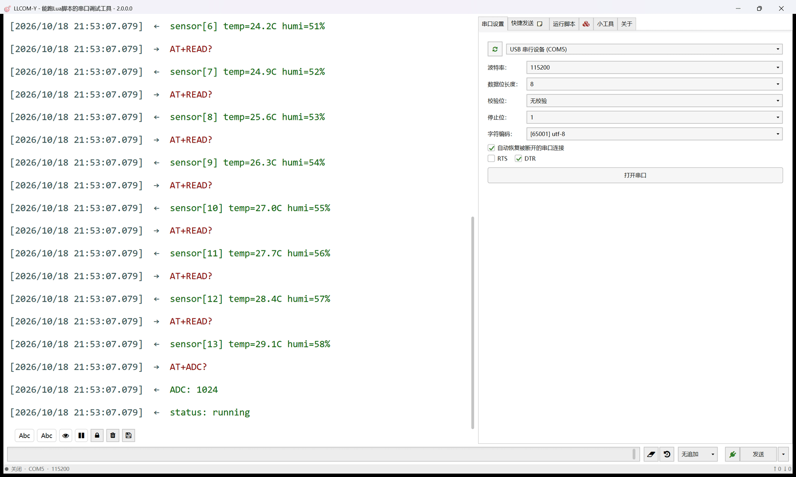
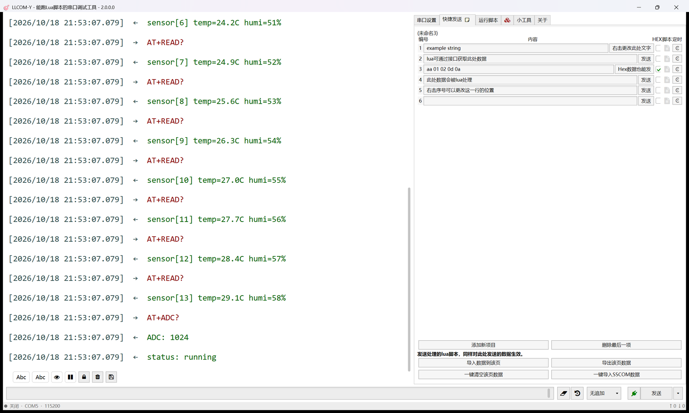
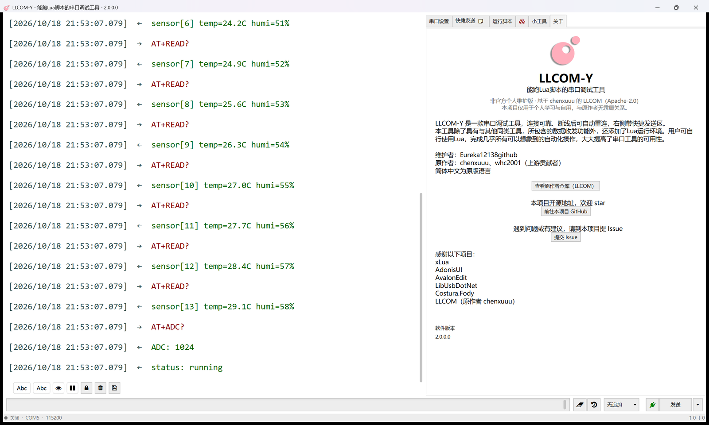

# LLCOM-Y

> ⚠️ **非官方个人维护版**
>
> 基于 [**chenxuuu/LLCOM**](https://github.com/chenxuuu/llcom)（Apache-2.0）修改而来。
> 原作者：chenxuuu 及[上游贡献者](https://github.com/chenxuuu/llcom/graphs/contributors)。
> 由 [Eureka12138github](https://github.com/Eureka12138github/llcom-y) 个人学习与自用维护，
> **不是官方版本**，与原作者无隶属关系，也不代表原作者背书。
> 相对上游的改动见 [CHANGES.md](CHANGES.md)。

[English readme click here](/README_EN.md)



可运行 Lua 脚本的串口调试工具（个人重构版）。

## 项目定位与风险（请先读）

- 这是一个**个人学习 / 自用**项目：主要目的是练习重构，并把自己日常用的串口工具调顺手。
- **不是**上游官方分支，也不保证与原版行为完全一致。
- **已验证**：x64 / x86 构建、单元测试（44 个）、串口收发与日志显示、发送记录、快捷发送 / 定时、串口设置等日常路径。
- **未完整回归**：TCP / UDP / MQTT / WinUSB / 串口监听 / 绘图 / 在线脚本 / 终端模式等「小工具」部分。它们大多继承自上游，本版本主要做了重构与去重，**可能存在回归**。
- 因此**不建议用于生产或关键任务**。使用前请备份配置；重要操作建议先在原版上确认。
- 维护是「按需」的，不保证及时修复；欢迎提 Issue，但不承诺响应时间。

## 功能

- 串口收发、收发日志（发送 / 接收分别切换 Abc/Hex、字号可调、暂停 / 锁定 / 清空 / 保存）
- 日志列表虚拟化；日志保留上限（默认 5 万条 / 32 MB 负载；流式模式 200 万字符）
- 发送记录（上限 5~200、键盘输入、一键清空）
- 快捷发送（10 页、每行独立定时）
- 串口设置独立标签页（端口 / 波特率 / 数据位 / 校验位 / 停止位 / 编码 / 自动重连 / RTS / DTR / 开关）
- 基于 XLua 的 Lua 脚本（发送 / 接收处理、独立运行；接口见 [LuaApi.md](LuaApi.md)）
- 社区脚本：官方（chenxuuu）/ 本项目（Eureka12138github）来源切换；本项目脚本按保存位置下载到对应目录（界面不显示分类标签），并可在 Discussions 投稿
- 继承自上游：TCP / UDP / MQTT / WinUSB / 串口监听 / 绘图 / 编码转换等工具（见上方风险说明）

## 截图

| 主界面 | 快捷发送 |
|---|---|
|  |  |



## 下载

- **exe 便携版**：从 [GitHub Releases](https://github.com/Eureka12138github/llcom-y/releases) 下载（首次发布后可用）
- **CI 快照**：[GitHub Actions](https://github.com/Eureka12138github/llcom-y/actions)
- **上游官方版本（原作者）**：[chenxuuu/llcom](https://github.com/chenxuuu/llcom)

> 本仓库不发布到微软商店；商店里的 LLCOM 是原作者版本。

## 构建

需要 .NET Framework 4.6.2（由 NuGet 参考程序集提供，无 Dev Pack 也可构建）与 .NET SDK：

```powershell
dotnet build llcom\llcom.csproj -c Release -p:Platform=x64
dotnet build llcom\llcom.csproj -c Release -p:Platform=x86
dotnet test tests\llcom.Tests\llcom.Tests.csproj -p:Platform=x64
```

产物在 `artifacts\Release\{x64|x86}\llcom-y.exe`（单文件，托管依赖由 Costura 嵌入）。
运行约束：exe 必须叫 `llcom-y.exe`；配置 / 脚本 / 日志默认写在程序目录（MSIX 安装时在 `%LOCALAPPDATA%\llcom\`）。

## 与上游的关系

- 本项目继承上游完整 git 历史，许可证为 **Apache-2.0**（见 [LICENSE](LICENSE)）。
- 原始代码版权归 chenxuuu 及贡献者；本版本的修改部分版权归 Eureka12138github。
- 相对上游的详细改动见 [CHANGES.md](CHANGES.md)；上游更新记录见原项目 Releases。
- 自动更新改为检查**本项目的 GitHub Releases**（启动时可开关）；热更新与崩溃上报仍关闭，不会向原作者发送任何数据。
- 从 v2.0.0.1（`llcom.exe`）升级到 2.0.0.2 时因可执行文件更名为 `llcom-y.exe`，请手动下载/替换一次；之后的自动更新正常。

## 开发与文档

- `docs/`：架构、维护、测试清单、发布与改进计划；入口见 [docs/README.md](docs/README.md)。
- `tests/llcom.Tests`：xUnit 单元测试。
- 架构：`ViewModels/`（界面逻辑）、`Services/`（服务）、`Model/`（模型）、`Pages/`（工具页）、`LuaEnv/`（Lua 引擎）。

## 许可与致谢

- 采用 **Apache-2.0**；原始版权 `Copyright 2021 chenxuuu`，修改部分 `Copyright 2026 Eureka12138github`。
- 感谢原作者 [chenxuuu](https://github.com/chenxuuu) 与所有[上游贡献者](https://github.com/chenxuuu/llcom/graphs/contributors)。
- 第三方项目：xLua、AdonisUI、AvalonEdit、LibUsbDotNet、Costura.Fody。
